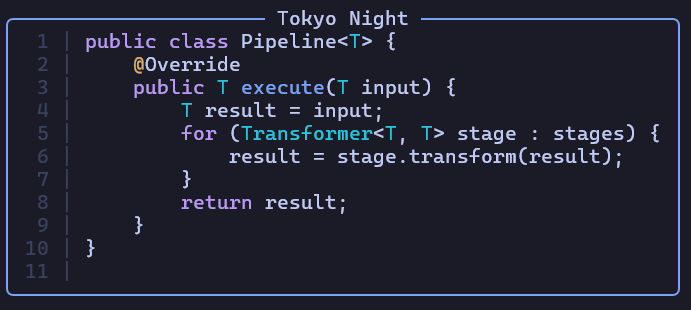
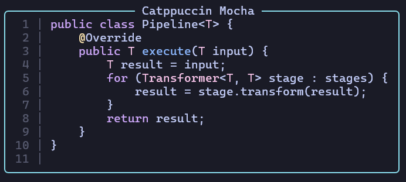

# Veneer

Syntax highlighting for Java, Python, Go, Lua, JavaScript, BibTeX, JSON, and XML via ANSI color codes. Built on [JavaParser](https://github.com/javaparser/javaparser), [ANTLR4](https://github.com/antlr/antlr4), and [Clique](https://github.com/kusoroadeolu/Clique).

---




## Requirements
- Java 21+

## Installation

```xml
<dependency>
    <groupId>io.github.kusoroadeolu</groupId>
    <artifactId>veneer</artifactId>
    <version>1.3.3</version>
</dependency>
```

---

## Usage

Each highlighter shares the same constructors and `highlight` / `print` methods. Swap in the class for your language.

```java
// Default
SyntaxHighlighter h = new JavaSyntaxHighlighter();

// With theme
SyntaxHighlighter h = new JavaSyntaxHighlighter(SyntaxThemes.CATPPUCCIN_MOCHA);

// Without line numbers
SyntaxHighlighter h = new JavaSyntaxHighlighter(false);

// Both
SyntaxHighlighter h = new JavaSyntaxHighlighter(SyntaxThemes.NORD, false);
```

```java
h.highlight(sourceCode);       // returns styled string
h.highlight(Path.of("...")); // reads file, returns styled string
h.print(sourceCode);           // prints to stdout
```

Available highlighters: `JavaSyntaxHighlighter`, `PythonSyntaxHighlighter`, `GoSyntaxHighlighter`, `LuaSyntaxHighlighter`, `JavaScriptSyntaxHighlighter`, `BibTeXSyntaxHighlighter`, `JSONSyntaxHighlighter`, `XMLSyntaxHighlighter`.

---

## Themes

| Constant                        | Description       |
|---------------------------------|-------------------|
| `SyntaxThemes.DEFAULT`          | IntelliJ-inspired |
| `SyntaxThemes.CATPPUCCIN_MOCHA` | Catppuccin Mocha  |
| `SyntaxThemes.GRUVBOX`          | Gruvbox Dark      |
| `SyntaxThemes.NORD`             | Nord              |
| `SyntaxThemes.TOKYO_NIGHT`      | Tokyo Night       |

### Custom themes

Implement `SyntaxTheme`:

```java
public class MyTheme implements SyntaxTheme {
    @Override public AnsiCode keyword()       { return Clique.rgb(255, 100, 100); }
    @Override public AnsiCode stringLiteral() { return Clique.rgb(100, 200, 100); }
    @Override public AnsiCode numberLiteral() { return Clique.rgb(100, 150, 255); }
    @Override public AnsiCode comment()       { return Clique.rgb(120, 120, 120); }
    @Override public AnsiCode annotation()    { return Clique.rgb(200, 200,  50); }
    @Override public AnsiCode method()        { return Clique.rgb(255, 200, 100); }
    @Override public AnsiCode gutter()        { return Clique.rgb( 80,  80,  80); }
    @Override public AnsiCode types()         { return Clique.rgb(170, 180, 200); }
    @Override public AnsiCode constants()     { return Clique.rgb(150, 120, 170); }
}
```

---

## Token categories

### Java
| Category    | Examples                                               |
|-------------|--------------------------------------------------------|
| Keywords    | `public`, `void`, `class`, `return` etc.               |
| Strings     | literals, text blocks, Javadoc                         |
| Numbers     | `42`, `3.14f`, `0xFF`                                  |
| Comments    | `//`, `/* */`                                          |
| Annotations | `@Override`, `@SuppressWarnings`                       |
| Methods     | Declared method and constructor names and method calls |
| Types       | `String`, `List`, `MyClass`                            |
| Constants   | `static final` fields, enum constants and field expr   |

### Python
| Category    | Examples                                              |
|-------------|-------------------------------------------------------|
| Keywords    | `def`, `class`, `return`, `yield`                     |
| Strings     | `"hello"`, `'world'`, f-strings                       |
| Numbers     | `42`, `3.14`, `0xFF`                                  |
| Comments    | `# comment`                                           |
| Annotations | `@staticmethod`, `@property`                          |
| Methods     | Declared function names                               |
| Types       | Return type hints (`-> int`, `-> dict`)               |
| Constants   | Names matching `ALL_CAPS` convention                  |

### Go
| Category  | Examples                                      |
|-----------|-----------------------------------------------|
| Keywords  | `func`, `package`, `var`, `const`, `return`   |
| Strings   | `"hello"`, raw string literals, rune literals |
| Numbers   | `42`, `3.14`, `0xFF`, `1i`                    |
| Comments  | `//`, `/* */`                                 |

### Lua
| Category  | Examples                                              |
|-----------|-------------------------------------------------------|
| Keywords  | `local`, `function`, `if`, `for`, `return`, `end`     |
| Strings   | `"hello"`, `'world'`, `[[long strings]]`              |
| Numbers   | `42`, `3.14`, `0xFF`                                  |
| Comments  | `--`, `--[[ block comments ]]`                        |

### JavaScript
| Category  | Examples                                                                        |
|-----------|---------------------------------------------------------------------------------|
| Keywords  | `const`, `let`, `function`, `class`, `async`, `await`, `null`, `true`, `false` |
| Strings   | `"hello"`, template literals                                                    |
| Numbers   | `42`, `3.14`, `0xFF`, `100n`                                                    |
| Comments  | `//`, `/* */`, JSX comments                                                     |
| Methods   | Declared function names                                                         |
| Constants | Names matching `ALL_CAPS` convention                                            |

### BibTeX
| Category  | Examples                                                        |
|-----------|-----------------------------------------------------------------|
| Keywords  | `@article`, `@book`, `@string`, `@preamble`, `@comment`         |
| Strings   | `{brace delimited}`, `"double quoted"`                          |
| Numbers   | `2024`, `42` (bare integer field values)                        |
| Comments  | `% line comment`                                                |
| Cite Keys | `knuth1984`, `DBLP:conf/pldi/PadhiSM16`                        |
| Fields    | `author`, `title`, `year`, `doi`                                |
| Macros    | `jan`, `kopp`, `PRL` (string macro references)                  |

### JSON
| Category  | Examples                   |
|-----------|----------------------------|
| Keywords  | `true`, `false`, `null`    |
| Strings   | `"hello"`, `"world"`       |
| Numbers   | `42`, `3.14`               |
| Constants | Key names `"name"`, `"id"` |

### XML
| Category  | Examples                                                              |
|-----------|-----------------------------------------------------------------------|
| Keywords  | `<?xml` declaration                                                   |
| Strings   | Attribute values, `<![CDATA[...]]>`                                   |
| Comments  | `<!-- -->`, processing instructions `<?...?>`                         |
| Constants | Entity refs `&amp;`, char refs `&#x27;`, attribute names              |
| Types     | Element and tag names                                                 |

---

## Known quirks

### Java

**`var` keyword** -> JavaParser treats `var` as an identifier, not a keyword. The highlighter handles this explicitly, so it styles correctly in all normal usage. The one edge case: using `var` as a variable name (which is legal Java) will still be styled as a keyword.

**Partial or invalid code** -> keywords, strings, literals, comments, and annotations are token-based and always highlight correctly. Method names, types, and constants require a successful AST walk, so they may fall back to unstyled text on incomplete snippets.

### Python

**Soft keywords** -> `match`, `case`, and `type` are always styled as keywords, even when used as variable names.

### Go

**`nil`** -> styled as a keyword since it falls within the keyword token range.

### JavaScript

**`null`, `true`, `false`** -> styled as keywords since they behave as reserved words.

**Template literal interpolation** -> the `${` punctuation is left unstyled; only the string content gets the string literal color.

### BibTeX

**`@comment` blocks** -> the entire body of a `@comment{...}` entry is consumed and hidden; inner field-like syntax is not highlighted.

**Brace-escaped quotes** -> `{"}` inside a double-quoted string value is treated as a literal brace block, allowing embedded quotes without breaking the string boundary.

**Concatenation** -> the `#` operator and macro references (e.g. `kopp # et # kubovy`) are supported; macro names are styled as types.

**Both delimiter styles** -> `@article{key, ...}` and `@article(key, ...)` are both recognized.